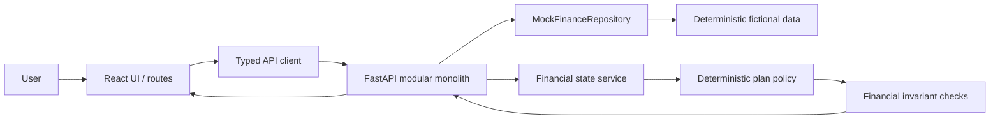

# Architecture

Phase 1 uses one FastAPI application and one Vite frontend. The browser never calculates allocation amounts. The API is the source for synthetic accounts, activity, goals, financial state and Flow Sync recommendations.

## Boundaries

- `apps/web/src/app`: routes and presentation. Pages render typed API responses.
- `apps/web/src/services`: HTTP calls and response types.
- `apps/api/app/schemas.py`: Pydantic API/domain contracts.
- `mock_data.py` and `repository.py`: coherent read-only fixture data and replaceable repository seam.
- `finance.py`: financial state access, input validation, plan policy and output invariants.
- `main.py`: HTTP routes and simulated confirmation lifecycle.

The repository is an in-memory mock adapter; there is no database because Phase 1 has no persistence need. Confirmed status lasts only for the API process. A later persistence decision should follow the actual plan lifecycle and data needs.

## Data flow

Salary and expense transactions plus a typed synthetic profile feed a typed financial state. Income, expense categories and account balances are derived from the central mock records. Monthly income less essential commitments and recorded flexible spending yields the available-to-plan amount. Flow Sync allocates that amount to an under-target emergency reserve, then the active goal. Essential costs are protected before this remainder is offered. Validation rejects negative values, non-positive income, essentials greater than income, and an available amount greater than income after essentials. Plans are proposals until the user confirms; confirmation stores no financial transaction.

The UI is served by Vite and proxies `/api` and `/health` to the local API. There are no remote runtime dependencies.
