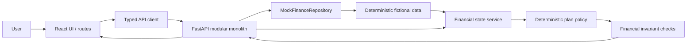
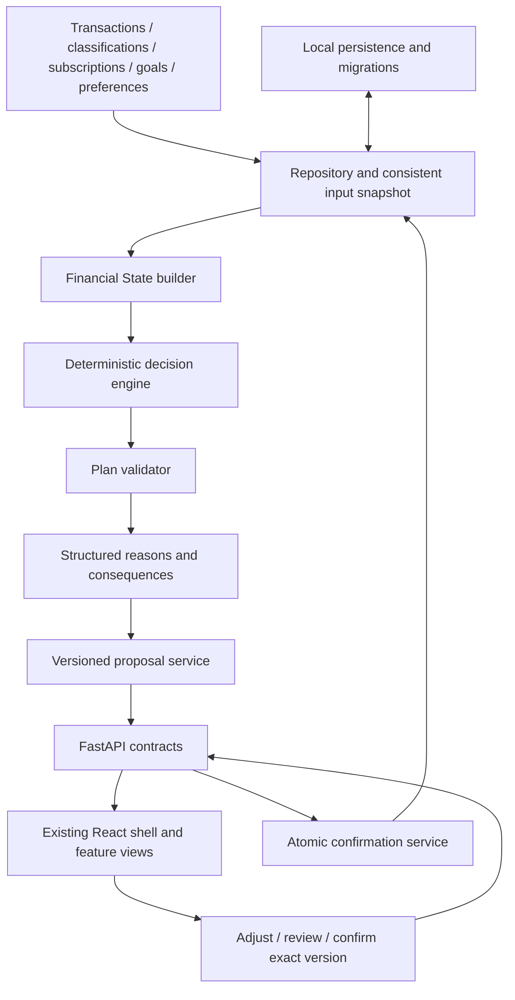

# Architecture — current runtime and PM-1.1 target

Phase 1 uses one FastAPI application and one Vite frontend. The browser never calculates allocation amounts. The API is the source for synthetic accounts, activity, goals, financial state and Flow Sync recommendations. The PM pass preserves this modular monolith. [Product specification](PRODUCT_SPEC.md) and [Integration plan](INTEGRATION_PLAN.md) describe the approved target and ownership; it is not yet implemented.

## Current Phase 1

## Boundaries

- `apps/web/src/app`: routes and presentation. Pages render typed API responses.
- `apps/web/src/services`: HTTP calls and response types.
- `apps/api/app/schemas.py`: Pydantic API/domain contracts.
- `mock_data.py` and `repository.py`: coherent read-only fixture data and replaceable repository seam.
- `finance.py`: financial state access, input validation, plan policy and output invariants.
- `main.py`: HTTP routes and simulated confirmation lifecycle.

The repository is an in-memory mock adapter; there is no database in Phase 1. The financial state builder and engine also import fixture globals directly, bypassing the repository seam. Accepted status lasts only for the API process. PM-1.1 requires persistent inputs, immutable proposal versions, confirmation history and observed progress, so this shortcut must be replaced during implementation.

## Phase 1 data flow (historical policy)

Salary and expense transactions plus a typed synthetic profile feed a typed financial state. Income, expense categories and account balances are derived from the central mock records. Monthly income less essential commitments and recorded flexible spending yields the available-to-plan amount. Flow Sync allocates that amount to an under-target emergency reserve, then the active goal. Essential costs are protected before this remainder is offered. Validation rejects negative values, non-positive income, essentials greater than income, and an available amount greater than income after essentials. Plans are proposals until the user confirms; confirmation stores no financial transaction.

The UI is served by Vite and proxies `/api` and `/health` to the local API. There are no remote runtime dependencies.

## Approved PM-1.1 boundaries

Data owns persistent relationships, migrations, occurrence/payment matching integrity, exact money, input snapshots and atomic repository writes. Frontend+Backend owns state, allocation, validation, explanations, HTTP schemas and user interaction. Services consume typed snapshots; SQL and fixture globals do not enter React or decision logic. UI formats server values and never supplies authoritative cash to preview.

Preferred persistence remains SQLAlchemy/Alembic with local SQLite and PostgreSQL-compatible design. Physical schema choices belong to Data. Source facts and immutable confirmed snapshots are stored; derived metrics are recomputed for this small dataset. General Savings, Emergency Fund and goal funding are exclusive designations, so account assets cannot be counted twice.

Confirmation writes a commitment only. It validates the same source revision and exact proposal that the user reviewed, with idempotent retry and atomic conflict detection. Observed synthetic transactions supply progress; a recalculation creates a separate proposal. See [Financial rules](FINANCIAL_RULES.md), [API contract](API_CONTRACT.md) and the repository seam in [Integration plan](INTEGRATION_PLAN.md) for semantics and acceptance gates.

Future bank/provider adapters remain unimplemented interfaces. No microservices, queues, Redis, ML, external APIs or policy-management platform are required.
